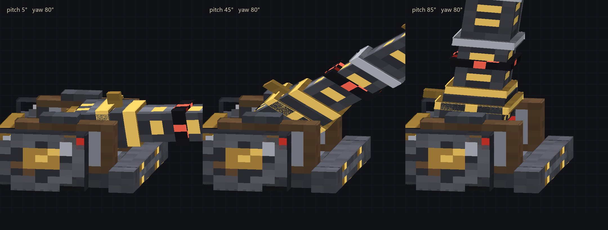
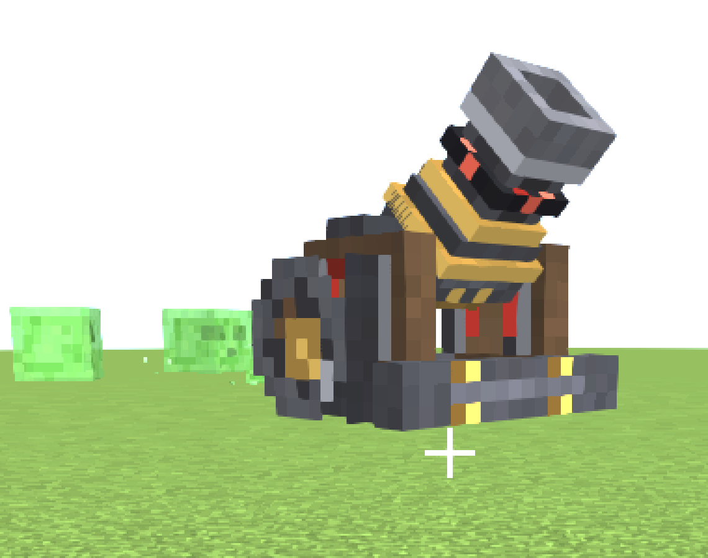
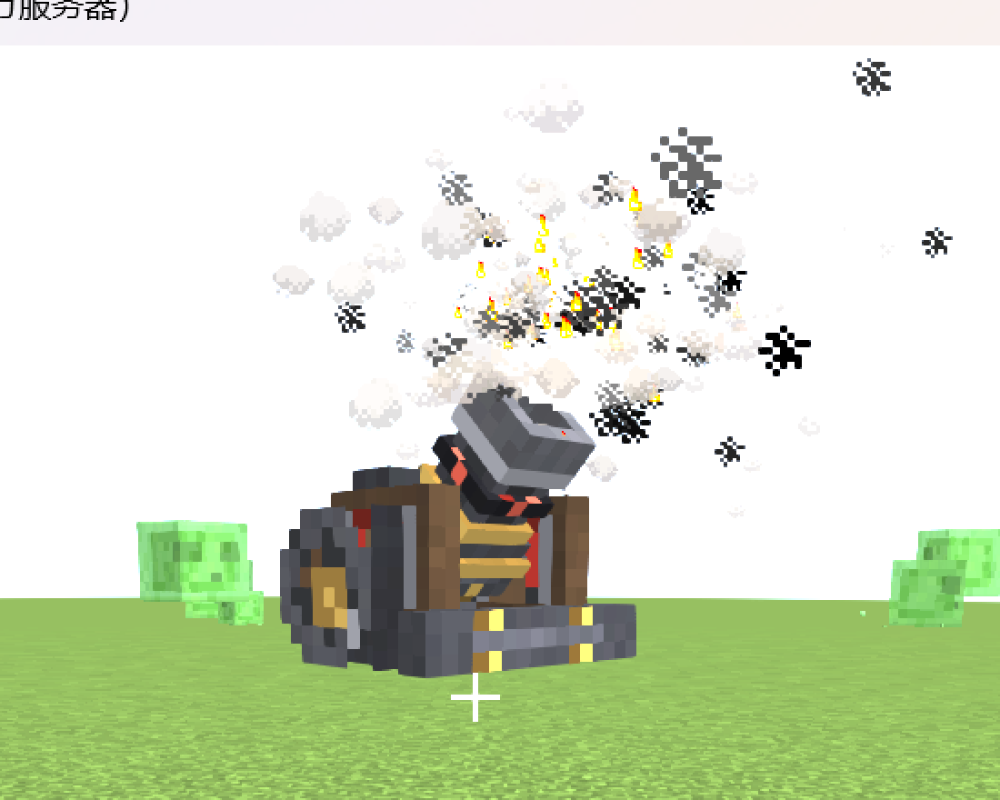

# 大炮模型 v2 与装填界面 v2 · 实现说明

> 对应需求：[`model-v2-requirements.md`](model-v2-requirements.md)  
> 实现日期：2026-10-25  
> **历史版本：** 这是 1× 模型版本；后续放大/炮弹/开火表现见 [`cannon-v3-implementation.md`](cannon-v3-implementation.md)。

## 1. 交付文件

| 文件 | 变化 |
| --- | --- |
| `src/main/java/com/cannonworks/client/CannonModel.java` | 重写为 30 个立方体的层级模型，枢轴移到炮尾 |
| `src/main/java/com/cannonworks/client/CannonRenderer.java` | 适配新枢轴；加入 8 tick 后坐与炮口火焰/烟粒子 |
| `src/main/java/com/cannonworks/block/CannonBlockEntity.java` | 新增 `fireGameTime`（同步 + 存档），仅用于客户端表现 |
| `src/main/java/com/cannonworks/client/CannonScreen.java` | 176×238 新界面、自绘滑条/按钮、状态灯、装填状态 |
| `src/main/java/com/cannonworks/menu/CannonMenu.java` | 三个机器槽与背包槽位对齐新图集 |
| `src/main/resources/assets/cannonworks/textures/entity/cannon.png` | 128×128 v2 图集（6.3 KB） |
| `src/main/resources/assets/cannonworks/textures/gui/cannon.png` | 256×256 GUI 图集，内容区 176×238（16.4 KB） |
| `src/main/resources/assets/cannonworks/textures/item/cannon.png` | 新 16×16 物品图标（同时作为 block 粒子贴图） |
| `src/main/resources/assets/cannonworks/lang/{zh_cn,en_us}.json` | 新增界面标题键 |
| `docs/cannon-v2-*.png` | 离线三视图、游戏内模型、游戏内界面截图 |

未改 `build.gradle`，未新增依赖，未改任何弹道/射程/冷却数值。

## 2. 模型

### 2.1 层级

```text
root
├─ base
│  ├─ 基础台座：foundation、front_beam
│  ├─ carriage：两侧炮架板、顶部压条、横撑
│  ├─ wheels：左右轮、车轴
│  └─ details：尾板、左右耳轴、前置支腿
└─ barrel（PartPose.offset(0, 5.4, -2.6)）
   ├─ breech：炮尾盖、闭锁块、尾部箍、后照门
   ├─ tube：肩部过渡、管身、前准星
   ├─ muzzle：上下左右四根炮口条 + 内膛
   └─ trim：两道箍环 + 赤红符文环
```

- 炮管局部 **+Z** 为炮口方向，`barrel.xRot = -pitch` 抬头；朝向仍由渲染器的 yaw 处理，没有烘进模型。
- `PIVOT_Y = 5.4`、`PIVOT_Z = -2.6`、`MUZZLE_Z = 11.0`，渲染器和炮口粒子共用这三个常量。
- 底座两侧留出 0.5 格内净空；炮尾在 5°–85° 全程保持在炮架开口内。

### 2.2 尺寸与边界

- 单位为 1/16 方块；共 30 个立方体（需求上限 ~40）。
- 全模型在俯仰 5°–85° 范围内的实际包围盒：

| pitch | X | Y | Z |
| --- | --- | --- | --- |
| 5° | −8.00 … 8.00 | 0.00 … 10.28 | −8.00 … 8.58 |
| 20° | −8.00 … 8.00 | 0.00 … 11.51 | −8.00 … 8.59 |
| 45° | −8.00 … 8.00 | 0.00 … 14.95 | −8.00 … 6.95 |
| 70° | −8.00 … 8.00 | 0.00 … 16.59 | −8.00 … 4.00 |
| 85° | −8.00 … 8.00 | 0.00 … 16.58 | −8.00 … 4.00 |

最大外扩为 **+0.67 单位**（约 +0.042 方块），落在需求允许的 ±0.05 方块内。方块碰撞箱、`getShape` 和破坏逻辑未改。

### 2.3 立方体 / UV 表

坐标格式为 `x, y, z, w, h, d`。炮管组的坐标是**相对枢轴**的局部坐标。

| 立方体 | 组 | 坐标 | `texOffs` |
| --- | --- | --- | --- |
| `foundation` | base | −6, 0, −8, 12, 2, 10 | 2,20 |
| `front_beam` | base | −6, 0, 2, 12, 3, 2 | 60,34 |
| `side_left` | carriage | −6, 2, −6, 2, 7, 8 | 46,2 |
| `side_right` | carriage | 4, 2, −6, 2, 7, 8 | 68,2 |
| `top_left` | carriage | −6, 9, −4, 2, 1, 3 | 18,42 |
| `top_right` | carriage | 4, 9, −4, 2, 1, 3 | 30,42 |
| `cross_brace` | carriage | −6, 2, −6, 12, 1, 1 | 38,49 |
| `wheel_left` | wheels | −8, 0, −8, 2, 8, 8 | 2,2 |
| `wheel_right` | wheels | 6, 0, −8, 2, 8, 8 | 24,2 |
| `axle` | wheels | −8, 2, −4, 16, 1, 1 | 2,49 |
| `rear_plate` | details | −4, 2, −8, 8, 5, 1 | 108,20 |
| `trunnion_left` | details | −4.5, 4.5, −3.5, 1, 2, 2 | 52,42 |
| `trunnion_right` | details | 3.5, 4.5, −3.5, 1, 2, 2 | 60,42 |
| `leg_left` | details | −8, 0, 2, 2, 3, 2 | 102,34 |
| `leg_right` | details | 6, 0, 2, 2, 3, 2 | 112,34 |
| `tail_cap` | breech | −2, −2, 0, 4, 4, 1 | 90,34 |
| `breech_block` | breech | −3.5, −2.5, 1, 7, 5, 3 | 68,20 |
| `breech_band` | breech | −3.5, −3, 3, 7, 6, 1 | 90,20 |
| `sight_rear` | breech | −0.5, 2.5, 3.5, 1, 2, 1 | 100,42 |
| `shoulder` | tube | −3, −2.5, 4, 6, 5, 1 | 2,34 |
| `tube` | tube | −2, −2, 5, 4, 4, 5 | 48,20 |
| `sight_front` | tube | −0.5, 2, 7.5, 1, 1, 1 | 66,49 |
| `muzzle_top` | muzzle | −2.5, 1.5, 9, 5, 1, 2 | 84,42 |
| `muzzle_bottom` | muzzle | −2.5, −2.5, 9, 5, 1, 2 | 68,42 |
| `muzzle_left` | muzzle | −2.5, −1.5, 9, 1, 3, 2 | 2,42 |
| `muzzle_right` | muzzle | 1.5, −1.5, 9, 1, 3, 2 | 10,42 |
| `bore` | muzzle | −1.5, −1.5, 8.5, 3, 3, 1 | 42,42 |
| `hoop_rear` | trim | −2.5, −2.5, 5, 5, 5, 1 | 32,34 |
| `hoop_front` | trim | −2.5, −2.5, 8, 5, 5, 1 | 18,34 |
| `rune_band` | trim | −2.5, −2.5, 6, 5, 5, 1 | 46,34 |

### 2.4 穿模自检

用 OBB（绕 X 轴旋转 + 底座 AABB）在 5°–85° 每 5° 做分离轴检测：**炮管组与 15 个底座立方体全部无交叠**。把 1.25 单位的后坐位移也算进去后，在 5°、10°、45°、70°、85° 五个关键角度同样无交叠。

## 3. 贴图

### 3.1 128×128 实体图集

- 尺寸 128×128（2 的幂），RGBA，最终 **6,463 B**，远低于 200 KB。
- 每个立方体仍使用标准 Minecraft 盒子展开，整块 UV 尺寸为 `2w+2d` × `(d+h)`：
  - 顶面 `(u+d, v, w, d)`
  - 底面 `(u+d+w, v, w, d)`
  - −X `(u, v+d, d, h)`
  - −Z `(u+d, v+d, w, h)`
  - +X `(u+d+w, v+d, d, h)`
  - +Z `(u+d+w+d, v+d, w, h)`
- 图集按 2 px 间隙打包，四周再向外扩 1 px 边，避免 mipmap 串色。
- 轮子侧面的圆角/轮辐区域做了 **alpha 镂空**，配合 `RenderType.entityCutout` 形成八边形轮廓，而不是方形轮子。

### 3.2 美术分层

- 黑铁/旧钢：`#3A3B42` ～ `#5A5A62` 区间；顶面提亮、侧面中间调、底面压暗。
- 深色炮架木纹 + 铁箍 + 黄铜铆钉。
- 赤红符文只出现在炮尾侧面和符文环，量控制在“点缀”级别。
- 炮口、内膛、轮毂、箍环分别用独立小立方体或独立 UV 岛，轮廓比纯贴图更清楚。

### 3.3 GUI 图集

- `textures/gui/cannon.png` 为 256×256，实际内容区 **176×238**（左上角）。
- 槽位框、铆钉、面板倒角、警示红条烘焙进图集；文字、数值、滑条和按钮由代码绘制。
- 176×238 在 1280×720、GUI Scale 自动（=3）下正好是 528×714，能完整收进屏幕；原 246 高的界面在 720p 会超出屏幕底部，这是本次同步修掉的实机问题。

## 4. 渲染与动画

### 4.1 后坐

- `CannonBlockEntity` 新增 `fireGameTime`，在 `fire()` 成功时写入服务器世界时间，随 `getUpdateTag` 同步，并写入 NBT。
- 渲染器用 `sin(age / 8 × π) × 1.25` 计算 8 tick 的后坐曲线，沿炮膛轴线反向平移炮管（不是简单沿世界 Z 轴）。
- 后坐完全由 BE 状态驱动；渲染器不读随机数。

### 4.2 炮口焰

- 同步的 `fireGameTime` 变化后的 1 tick 内，在 `PIVOT + bore × MUZZLE_Z` 位置生成：
  - 12 个 `ParticleTypes.FLAME`
  - 8 个 `ParticleTypes.SMOKE`
- 用 `BlockPos -> 已喷焰的 fireGameTime` 小表去重，避免每帧重复生成。
- 粒子散布用固定三角函数，不引入客户端随机源。

## 5. 装填界面

### 5.1 布局

| 区域 | 内容 |
| --- | --- |
| 顶部 0–20 | 标题、MK.II、状态灯、黄铜角饰 |
| 左舱 22–144 | 火药/填充/货物三槽、引信模式按钮、射程 R / 飞行 T |
| 右板 22–144 | 俯仰/方位/装药滑条、状态行、X/Z 坐标 + 解算、点火按钮、键盘提示 |
| 底部 145–238 | 3 行背包 + 快捷栏 |

- 机器槽坐标：`35, 25 / 35, 53 / 35, 81`；玩家背包 `158/176/194`，快捷栏 `216`。
- 屏幕尺寸 `176×238`，`inventoryLabelY = 148`。

### 5.2 自绘控件

- **AimSlider**：14 px 高，顶部标签/数值，底部细轨 + 红色进度 + 黄铜滑块；拖动仍由 `CannonScreen.mouseClicked/mouseDragged` 接管，绕开 `AbstractContainerScreen` 吞拖拽的问题。
- **SteelButton**：黑铁底、黄铜边、悬停高亮；点火按钮单独用暗红底和禁用态。
- **状态灯 / 状态行**：`待发`（绿）、`装填中 x.xs`（红）、`缺少火药`（红）、`装药为零`（黄）、`锁定 N`（黄）。
- 点火按钮的可用性在客户端由「冷却 + 装药 + 火药槽」判断，服务端仍会再次校验；没有新增网络包。

## 6. 兼容性与服务端安全

- `CannonModel` / `CannonRenderer` / `CannonScreen` 仍在 `Dist.CLIENT` 注册链路内；专用服务器启动通过。
- 新增的 `fireGameTime` 是普通 `long` 字段，不引用客户端类。
- 没有修改 `getRenderBoundingBox()`、`CannonBlock.getShape()`、射程/冷却/装药/弹道/Waystone 逻辑。
- `build.gradle`、依赖列表、网络协议均未改。

## 7. 验收记录

| 项目 | 结果 |
| --- | --- |
| `gradlew build` | ✅ `BUILD SUCCESSFUL`，产物 `build/libs/cannonworks-0.1.0.jar` |
| 专用服务器 | ✅ `Done (1.558s)!`；`Waystones present: true`；无模型/渲染类加载错误 |
| 客户端 1280×720 | ✅ 模型正常渲染；装填界面完整显示（GUI Scale 自动=3） |
| 开火链路 | ✅ RCON `/cannon block load 200 -60 200 0 minecraft:gunpowder 64` + `/cannon block fire 200 -60 200` 成功，日志可见 `Cannon fired ... range 2400 pitch 45` |
| 2 的幂贴图 | ✅ 实体 128×128、GUI 256×256 |
| 贴图大小 | ✅ 实体 6.3 KB、GUI 16.4 KB（均 < 200 KB） |
| 1×1×1 边界 | ✅ 最大外扩 +0.67 单位（+0.042 方块） |
| 5°–85° 穿模 | ✅ OBB 检测无交叠（含后坐位移） |
| 四向朝向 | 渲染器 yaw 逻辑保持原实现；本次未逐向截图，建议实机按 4 个 `facing` 放一次 |
| 炮口焰 | ✅ 实机抓帧成功（见下方 `cannon-v2-fire.png`）：12 FLAME + 8 SMOKE |
| 后坐 | 曲线和边界已验证；未单独逐帧截图，建议实机再确认一次观感 |

## 8. 预览图



*离线几何 + 实际纹理的等轴预览，pitch 5°/45°/85°，yaw 80°；不是游戏截图。*



*游戏内 1280×720 实机截图裁切；pitch 45°，yaw 0（炮口朝南）。*



*游戏内开火瞬间：炮口焰和烟从炮口沿炮膛方向喷出；同时验证了服务端开火链路和客户端粒子路径。*


*游戏内装填界面，GUI Scale 自动=3；火药槽为空时的“缺少火药”状态。*

## 9. 复现 / 检查命令

```powershell
cd "G:\我的世界大炮计划"
.\gradlew.bat build
.\gradlew.bat runServer
.\gradlew.bat runClient
```

客户端热键：`↑↓←→` 微调 1°，`Shift` 加速到 5°，`PgUp/PgDn` 装药，拖动滑条大范围调整。  
离线三视图由 `.cache/gen_model_v2.py` 生成（缓存目录不入库）；若后续改立方体尺寸，必须同步重跑图集生成并重新检查 `texOffs`。
