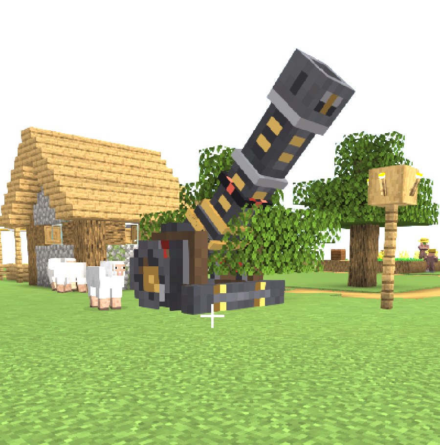
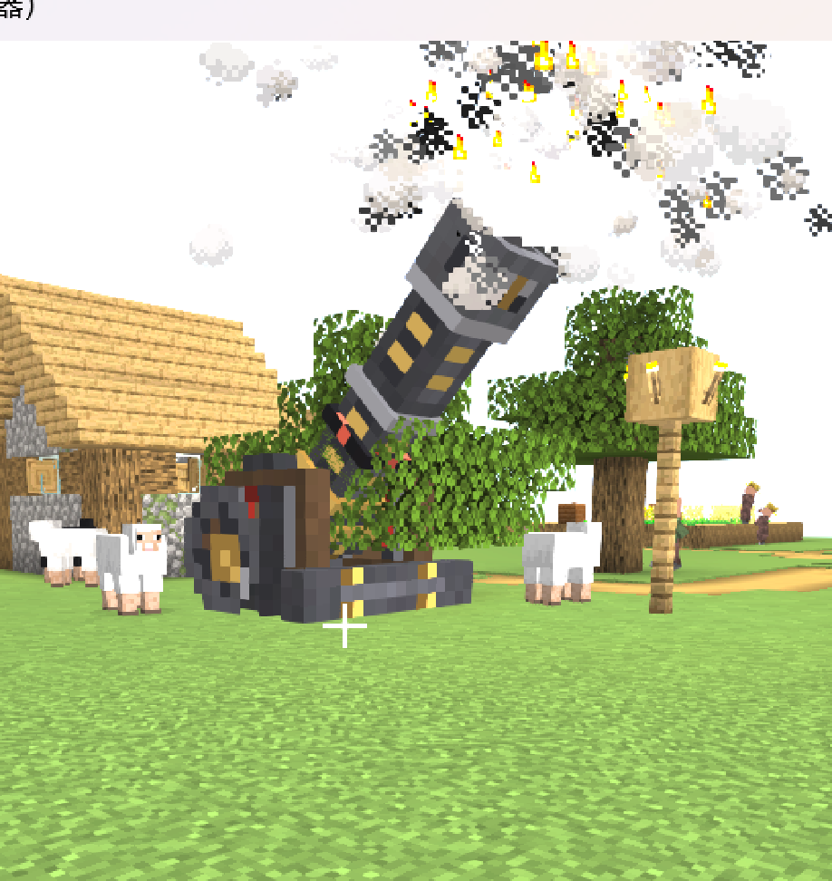
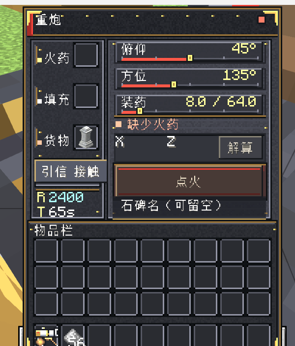

# 大炮 v3.3 · 旋转碰撞、75% 尺寸、长炮管与界面

> 基于 v2 的升级：**多格尺寸重炮 + 实体炮弹模型 + 震撼开火反馈**。  
> v3.3：碰撞跟随炮台方位角旋转，底座空心处不再有空气墙；同时打磨石碑命名框。
> 日期：2026-10-25  
> 构建：`gradlew build` 通过；专用服务器和 1280×720 开发客户端均已实机检查。

## 1. 这次改了什么

| 问题 | 处理 |
| --- | --- |
| 大炮比例偏大，想要更紧凑 | 模型整体缩到原来的 **75%**（`MODEL_SCALE = 4.0`） |
| 炮管还不够长 | 炮管从 12 模型单位加长到 **24 单位 = 6 格**（视觉上的约 1.5 倍） |
| 碰撞穿模 / 空气墙 | 改为 **5×5×2 查询网格 + 按方位角裁切的动态形状**；空网格无碰撞，模型转到哪碰撞跟到哪 |
| 界面标题 / 物品图标 | 标题只保留“重炮”；换成侧视炮车图标（大轮 + 水平炮管 + 尾架） |
| 炮弹还是铁块占位 | 新增 **11 立方体炮弹模型**、128×128 贴图、尾翼、飞行滚转和尾焰拖尾 |
| 开火不够震撼 | 炮口 **200+ 粒子**、低频爆炸声、相机震动、约 0.88 格炮管后坐 |
| 炮口位置和画面不一致 | `CannonGeometry` 统一渲染、炮口粒子、弹道起点 |

## 2. 调整后的尺寸

建模仍保持 1× 坐标（单位 1/16 格），渲染和炮口坐标统一乘 `MODEL_SCALE = 4.0`。共享常量在 [CannonGeometry.java](../src/main/java/com/cannonworks/block/CannonGeometry.java)。

| 项 | 模型单位 | 实际大小 |
| --- | --- | --- |
| 炮管口径（内膛） | 3 | **0.75 格** |
| 炮管长度（枢轴到炮口） | 24 | **6.00 格** |
| 炮口外径 | 5 | 1.25 格 |
| 底座宽 | 16 | **4.00 格** |
| 底座高 | 10 | 2.50 格 |
| 碰撞查询结构 | — | **5×5×2 格**（49 个占位块，碰撞形状按方位角动态裁切） |
| 炮管枢轴 | `(0, 6.9, -2.6)` | 高约 1.73 格、后移 0.65 格 |
| 85° 时最高点 | 31.03 | **约 7.76 格** |
| 低角度最大前伸 | 21.53 | 约 5.38 格（从方块中心算） |
| 后坐距离 | 3.5 | **约 0.88 格** |

- **31 个立方体**（底座 14 + 炮管 17），未超过原需求的 ~40 个。
- 渲染器按 `MODEL_SCALE` 缩放底座和炮管；炮管后坐先在**未缩放的世界坐标**里算好，再进入炮管坐标，避免放大后位移算错。
- 删除原 `axle` 横轴，并把耳轴上移到新枢轴高度，为后坐让出空间；炮管加长用两段 tube + 中箍实现。

### 2.1 边界 / 穿模复查

- 炮管组与 14 个底座立方体在 **5°–85° 每 5°** 做 OBB 分离轴检测：全部无交叠。
- 把 **3.5 单位（0.88 格）后坐**算进去后，在 5°、10°、45°、70°、85° 仍无交叠。
- 世界最大高度约 7.76 格，最大前伸约 5.38 格；不再受原 1×1×1 约束。

### 2.2 关键立方体 / UV

完整 UV 仍按标准盒子展开：整块 `2w+2d × (d+h)`。炮管坐标相对枢轴。

| 立方体 | 组 | 坐标 | `texOffs` |
| --- | --- | --- | --- |
| foundation | base | −6,0,−8,12,2,10 | 2,20 |
| front_beam | base | −6,0,2,12,3,2 | 16,43 |
| side_left / right | carriage | ±(4..6),2,−6,2,7,8 | 46,2 / 68,2 |
| top_left / right | carriage | ±(4..6),9,−4,2,1,3 | 2,51 / 14,51 |
| cross_brace | carriage | −6,2,−6,12,1,1 | 58,51 |
| wheel_left / right | wheels | ±(6..8),0,−8,2,8,8 | 2,2 / 24,2 |
| rear_plate | details | −4,2,−8,8,5,1 | 44,34 |
| trunnion_left / right | details | ±(3.5..4.5),5.9,−3.5,1,2,2 | 36,51 / 44,51 |
| leg_left / right | details | ±(6..8),0,2,2,3,2 | 98,43 / 108,43 |
| tail_cap | breech | −2,−2,0,4,4,1 | 86,43 |
| breech_block | breech | −3.5,−2.5,1,7,5,3 | 98,20 |
| breech_band | breech | −3.5,−3,3,7,6,1 | 2,34 |
| sight_rear | breech | −0.5,2.5,3.5,1,2,1 | 52,51 |
| shoulder | tube | −3,−2.5,4,6,5,1 | 64,34 |
| tube_rear | tube | −2,−2,5,4,4,8 | 48,20 |
| tube_front | tube | −2,−2,13,4,4,7 | 74,20 |
| sight_front | tube | −0.5,2,18,1,1,1 | 86,51 |
| muzzle_top / bottom | muzzle | −2.5,±(1.5/2.5),20,5,1,4 | 66,43 / 46,43 |
| muzzle_left / right | muzzle | ±(1.5..2.5),−1.5,20,1,3,4 | 20,34 / 32,34 |
| bore | muzzle | −1.5,−1.5,19.5,3,3,1 | 26,51 |
| hoop_rear | trim | −2.5,−2.5,5,5,5,1 | 108,34 |
| hoop_mid | trim | −2.5,−2.5,12,5,5,1 | 94,34 |
| hoop_front | trim | −2.5,−2.5,19,5,5,1 | 80,34 |
| rune_band | trim | −2.5,−2.5,9,5,5,1 | 2,43 |

## 3. 炮弹模型

新增：

- [CannonShellModel.java](../src/main/java/com/cannonworks/client/CannonShellModel.java)：11 个立方体，局部 +Z 为弹头方向。
- [CannonShellRenderer.java](../src/main/java/com/cannonworks/client/CannonShellRenderer.java)
- `textures/entity/cannon_shell.png`：**128×128**、5.8 KB。

| 部件 | 坐标（x,y,z,w,h,d） | 作用 |
| --- | --- | --- |
| body | −5,−5,−10,10,10,14 | 黑铁弹体，直径 0.625 格 |
| band_rear / band_front | 12×12×1 | 两道黄铜箍 |
| rune_band | 11×11×1 | 赤红符环 |
| nose | 8×8×5 | 钢制风帽 |
| tip | 4×4×3 | 红色引信头 |
| tail | 8×8×2 | 尾座 |
| fin_top / bottom / left / right | 2×2×6 | 四片尾翼，展开直径 0.875 格 |

- 总长 24 单位 = **1.5 格**，直径 0.625 格，能塞进 0.75 格口径的炮膛。
- 朝向使用 **SynchedEntityData** 同步的 yaw/pitch；服务端每个 tick 写入，客户端不再依赖不可靠的 `getDeltaMovement()`。
- 渲染时按飞行方向旋转，并叠加 `tickCount × 27°` 的自旋。
- 每 2 tick 在弹尾生成火焰/烟，每 4 tick 补一个大营火烟；不读客户端随机数。
- 服务端仍是权威飞行，实体只是视觉载体，原有区块卸载重建逻辑不变。

## 4. 开火表现

### 4.1 炮口粒子与声音（服务端广播）

在 `CannonBlockEntity.fire()` 里从真实炮口位置调用 `ServerLevel.sendParticles`，附近所有玩家都能看到：

| 粒子 | 数量 |
| --- | --- |
| `CAMPFIRE_COSY_SMOKE` | 80 |
| `LARGE_SMOKE` | 50 |
| `FLAME` | 40 |
| `CLOUD` | 35 |
| `EXPLOSION` | 1 |

声音：

- `GENERIC_EXPLODE`，音量 8、音高 0.45（低频炮响）
- `FIREWORK_ROCKET_BLAST`，音量 2.5、音高 0.55（高频冲击）

不新增任何音频文件/依赖。

### 4.2 屏幕震动

- 新增 [CannonShake.java](../src/main/java/com/cannonworks/client/CannonShake.java)。
- 监听 `ViewportEvent.ComputeCameraAngles`，在 650 ms 内给 yaw/pitch/roll 叠加衰减正弦偏移。
- 由 BE 同步的 `fireGameTime` 驱动；按玩家到炮口距离衰减，最大约 1.8°。
- 打开 GUI 后点火时，`CannonScreen.fire()` 会先触发一次；渲染器随后按同一发 `fireGameTime` 去重。
- 只改相机表现，不改玩家实际朝向。

### 4.3 后坐

- 10 tick 正弦曲线，峰值 3.5 模型单位 = **0.88 格**。
- 沿炮膛轴线后退，而不是沿世界 Z 轴；低角度/高角度都正确。
- 已做含后坐位移的穿模检测。

## 5. 碰撞与交互

用户问碰撞体积由谁改：这是代码侧的事，我已经直接改了。

### 5.1 为什么不再用“超大 VoxelShape”

第一次尝试是把 `CannonBlock.getShape/getCollisionShape` 返回一个 4×4×2.5 的盒子。实际测试发现：

- 选中框会变大；
- 但 Minecraft 的碰撞/射线查询只会查询**方块自身 1×1 范围内**的 shape，超出部分不会被邻格查询到；
- 结果是玩家仍能从旁边穿过去，右键打在视觉底座上也不会命中。

所以这个方案只能“画框”，不能真正碰撞。

### 5.2 现在的做法：查询网格 + 动态裁切

- 新增 `CannonPartBlock`：无 BlockEntity、无掉落、无渲染，但占据一个查询格。
- `CannonMultiblock` 在炮台周围铺 **5×5×2** 的查询网格（49 个占位块），覆盖炮台转到任意角度可能扫到的范围。
- 每个占位块的 `getShape` / `getCollisionShape` 由 `CannonCollision` 实时计算：
  - 取 `CannonModel` 的 14 个底座立方体；
  - 按当前 `Yaw` 绕方块中心旋转；
  - 只保留落进自己 1×1 格子里的部分；
  - **没有模型经过的格子返回 `Shapes.empty()`**，所以空心处可以直接走过去。
- 旋转是实时读取 BE 的 yaw，不依赖方块状态，也不需要在拖动滑条时批量更新 49 个方块。
- 右键/破坏仍由占位块转发给控制器；破坏任意一块会拆掉整台炮。

### 5.3 现在的表现

- 炮台转 0°/45°/90°/135° 时，碰撞轮廓跟着转；
- 底座空心处不再整格空气墙；
- 炮管本身不做碰撞，避免炮口附近变成隐形墙；
- 旧版 4×4 占位块仍兼容，形状会按新规则重算。

## 6. 界面

- GUI 仍是 **176×238**，256×256 图集；720p 自动 GUI Scale=3 下 528×714，完整可见。
- 标题现在只显示 **“重炮”**；已移除旧作品名与版本后缀，避免重名。
- 物品图标改为侧视炮车：大轮、水平炮管、炮尾和尾架；16×16 原生像素，block 粒子图同步更新。
- 货物槽放石碑时，底部提示行换成命名框；现在是无边框内嵌输入线 + 暗底 + 黄铜下划线，不再像一块突兀的黑色对话框。
- 装填槽/背包槽布局、滑条、按钮、状态灯未变；本次只增加 `CannonScreen.fire()` 的局部震动触发。

## 7. 自动化 / 截图方式（调研结论）

查到的可选方案：

| 方案 | 能做什么 | 局限 |
| --- | --- | --- |
| [Mineflayer](https://github.com/PrismarineJS/mineflayer)（Node.js 协议 bot） | 连服务器、移动、右键、发命令、读状态 | 不跑客户端渲染，看不到本模组模型/粒子；适合逻辑测试 |
| [MCCTP](https://github.com/lucasoyen/mcctp)（Fabric WebSocket 控制） | 通过 WebSocket 读游戏状态、发操作 | Fabric 侧；Forge 1.20.1 需另找/移植 |
| [Minaret](https://github.com/Vany/minaret)（WebSocket 控制） | 远程输入/状态 | 版本较老，同样不解决自定义渲染截图 |
| [PyAutoGUI](https://pyautogui.readthedocs.io/) / AutoHotkey | 键鼠、窗口、截图 | 受焦点、DPI、窗口位置影响；需要额外稳定化 |
| Forge 客户端调试命令/测试 harness | 固定相机、放炮、截图、退出 | 最可靠，但需要给模组加临时代码 |

本次采用的组合：

1. 开发客户端 `runClient --quickPlayMultiplayer ...`（真实渲染）。
2. 专用服务器 + RCON：放方块、装药、点火、传送/转视角。
3. Python + Pillow `ImageGrab` 连续抓帧；PowerShell/Win32 移动窗口、发 F2。
4. 结果：抓到了大炮实机图、炮口烟、炮弹尾焰轨迹。

结论：**当前不需要额外装 Minecraft 插件**。如果以后要做批量回归（多角度、多俯仰、自动对比），值得加一个客户端 debug 命令或独立 Forge 测试 harness；Mineflayer 更适合纯服务端逻辑。

## 8. 验证

| 项目 | 结果 |
| --- | --- |
| `gradlew build` | ✅ |
| 专用服务器 | ✅ 正常启动；Waystones 存在 |
| 放大模型实机渲染 | ✅ 75% 尺寸、6 格长炮管；见 `cannon-v3-ingame.png` |
| 开火烟雾/炮口焰 | ✅ 见 `cannon-v3-fire.png`；服务端 200+ 粒子 |
| 炮弹拖尾 | ✅ 连续抓帧能看到尾焰轨迹；满速飞行时弹体很小，未抓到清晰特写 |
| 后坐/穿模 | ✅ OBB 5°–85° 每 5° 无交叠，含 0.88 格后坐 |
| 碰撞占位块 | ✅ 实机：`/cannon probe` 在 0°/45°/90°/135° 得到不同的旋转轮廓，空角为 MISS |
| 碰撞防穿透 | ✅ 动态形状覆盖底座 14 个立方体；空心格返回 empty，不再整格空气墙 |
| 石碑命名框 | ✅ 实机放入 Waystone 后显示无边框内嵌输入线，布局未压到物品栏 |
| GUI 720p | ✅ 528×714 完整显示 |
| 四个朝向 | 未逐向截图；yaw 逻辑未改，建议实机转一圈确认 |
| 贴图体积 | 128×128、均 < 200 KB |

## 9. 已知限制

1. **控制器 + 49 个查询占位块**：碰撞形状按 yaw 动态裁切；占位块不是独立方块实体，破坏任意一块会拆掉整台炮。
2. **炮口在锚点前方 6 格**：弹道起点、炮口粒子、炮弹生成点已经全部改到真实炮口；方块交互覆盖 5×5 查询网格。
3. **四向朝向**未逐一截图；碰撞形状读取的是实际 yaw，不依赖 FACING。
4. **炮弹特写**未抓到：满速 50 格/秒、飞行高度高；已确认模型/尾焰代码路径在客户端运行。
5. GUI 文字仍是中文硬编码（标题走 lang key），英文客户端会出现中英混排。

## 10. 截图



*当前为 75% 尺寸；口径 0.75 格、炮管 6 格。图中是 45° 俯仰。*



*服务端 200+ 粒子；实机开火瞬间。*



*界面布局未变；720p 下完整可见。*

## 11. 复现

```powershell
cd "G:\我的世界大炮计划"
.\gradlew.bat build
.\gradlew.bat runServer
.\gradlew.bat runClient
```

PCL 测试环境的 jar 已同步覆盖到：

```text
E:\LMQ\NEW\落幕曲1.5.3解压包（解压即可）\.minecraft\versions\测试环境\mods\cannonworks-0.1.0.jar
```

替换 jar 后需要重启「测试环境」客户端。
